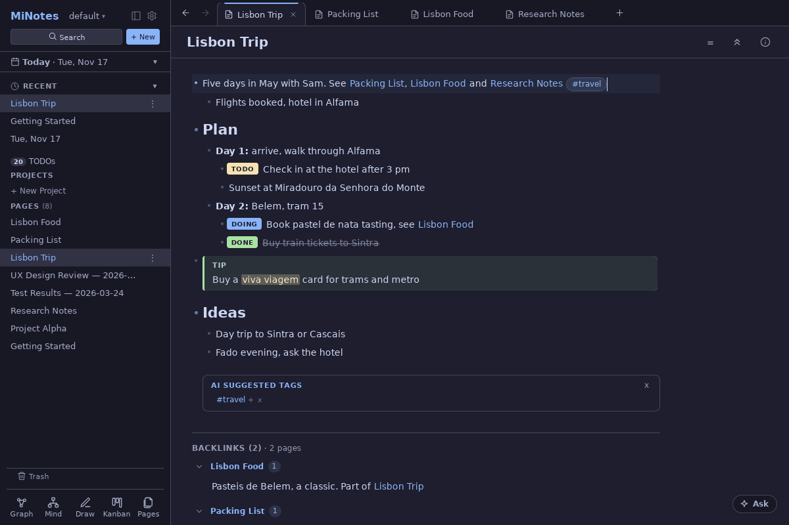
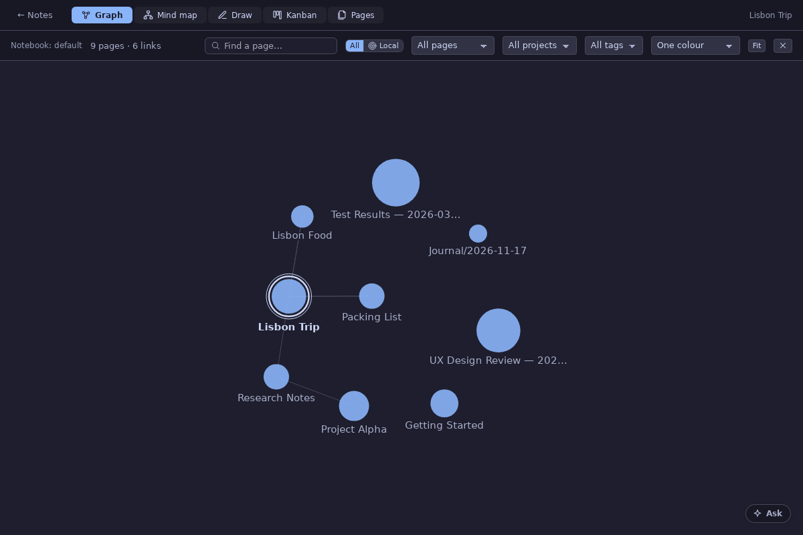

# MiNotes

**A local-first outliner for notes you own.** Write in blocks, link pages with `[[double brackets]]`, keep a daily journal, and open as many tabs as you like. Your notes live in a folder on your own computer, not on someone else's server.

MiNotes can encrypt a notebook, sync it between your devices through a git remote you choose, and import your existing notes from Evernote, Obsidian or a folder of markdown files.



## Download

Get the installer for your system from the **[latest release](https://github.com/Cklaus1/MiNotes/releases/latest)**.

| System | Pick this file |
|---|---|
| Windows 10 / 11 | `MiNotes_…_x64-setup.exe` (or the `.msi`) |
| Linux, any distribution | `MiNotes_….AppImage` |
| Debian, Ubuntu, Mint | `MiNotes_….deb` |
| Fedora, openSUSE | `MiNotes-….rpm` |
| Android (test build) | `MiNotes_…_android-debug.apk` — sideload it ("install unknown apps"); a debug build for trying out, not a store release |
| macOS (experimental) | `MiNotes_…_universal.dmg` (Apple Silicon and Intel). Not signed by Apple yet: the first time, right-click the app and choose **Open** |

**Windows:** the installers are not signed yet, so Windows SmartScreen may say "Windows protected your PC". Click **More info**, then **Run anyway**.

**Linux:**

```bash
chmod +x MiNotes_*.AppImage && ./MiNotes_*.AppImage     # AppImage
sudo apt install ./MiNotes_*.deb                         # Debian / Ubuntu
sudo dnf install ./MiNotes-*.rpm                         # Fedora
```

More detail, including where your notes are stored and how to uninstall: [Install guide](docs/guide/install.md).

## Quick start

1. Install and start MiNotes. The first page you see is **Getting Started**; it shows the basics and you can delete it whenever you like.
2. Click into a block and type. **Enter** starts a new block, **Tab** indents it under the one above, **Shift+Tab** moves it back out.
3. Type `[[` to link to another page. Pick an existing page from the list, or create a new one from there.
4. **Ctrl+K** searches everything; **Ctrl+J** opens today's journal; **Ctrl+T** opens a new tab; **Ctrl+/** lists every shortcut.
5. Coming from another app? Press **Ctrl+Shift+I** to [import your Evernote, Obsidian or markdown notes](docs/guide/import.md).

## Highlights

**Writing and linking**
- Block outliner with indent, collapse, drag to reorder, and slash (`/`) commands for headings, to-dos, tables, callouts, code and more.
- `[[Page links]]` with backlinks and unlinked mentions, `((block references))` and embeds, tags and page properties.
- To-dos (`TODO`, `DOING`, `DONE`) collected in a Tasks view; templates; per-day journal pages.
- Images, PDFs and file attachments in your notes.

**Finding your way around**
- Tabs, back and forward, a command palette (Ctrl+K) with typo-tolerant search across pages, blocks and journals, projects (folders) and pinned pages.
- Light and dark themes.

**Other ways to see your notes**


- Link graph, kanban board (columns by status or by a property), mind map, and per-block whiteboards.

**Keeping notes safe**
- Encrypted notebooks (the whole database is encrypted, with a recovery key).
- A readable markdown copy of each notebook (not for encrypted ones), and zip export of a whole notebook.
- [Git sync](docs/guide/sync.md) between devices, with a conflict view that lets you keep either version or both.

**For power users**
- A `minotes` command-line tool for scripting and a SQL query panel. See [CONTRIBUTING.md](CONTRIBUTING.md#the-minotes-command-line-tool).

## Privacy

- **Local first.** Notebooks are files on your disk. There is no account and no MiNotes server.
- **No telemetry.** The app contains no analytics or crash-reporting code, and no automatic update check.
- **Sync goes only where you point it.** Git sync is off until you set it up, and it uses only the remote address you give it, with your own git credentials. Encrypted notebooks sync as encrypted files.
- **Images from the web are blocked by default.** A web image in a note shows a placeholder until you allow it (Settings, Privacy).
- **AI is off by default.** Nothing is sent anywhere unless you pick a provider and add your own key in Settings. Link preview cards fetch the title and image of a web address you put in a note.

## Documentation

[User guide](docs/guide/README.md): [install](docs/guide/install.md), [getting started](docs/guide/getting-started.md), [import](docs/guide/import.md), [sync](docs/guide/sync.md), [encryption](docs/guide/encryption.md), [FAQ](docs/guide/faq.md). Changes by version: [CHANGELOG](CHANGELOG.md).

Questions and ideas are welcome in [Discussions](https://github.com/Cklaus1/MiNotes/discussions); bugs go in [Issues](https://github.com/Cklaus1/MiNotes/issues/new/choose). To report a security problem privately, see [SECURITY.md](SECURITY.md).

## License

[MIT](LICENSE).

## Contributing

Build instructions, tests and project rules are in [CONTRIBUTING.md](CONTRIBUTING.md).
